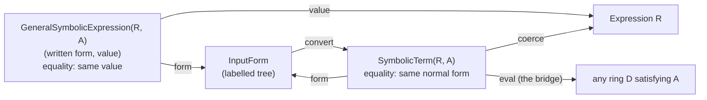

# Symbolic expressions for FriCAS: introduction and tutorial

*A re-introduction for fricas-devel readers and a starting point for new users. Written 2026-11-27 against `billpage/fricas-symbolic` at commit `54811c7` and FriCAS 1.4.0 (SBCL 2.6.10).*

**Every transcript in this document is output of [`tutorial.input`](tutorial.input), or in §7 of the two `known-issue-*.input` scripts, copied from a run, not typed.** The runs are listed in [§8](#8-how-this-document-was-checked). Results are shown in FriCAS's one-line form, which can be pasted back as input; at a terminal you see the same values in two-dimensional form.

**Contents.** Part I (§1–§5) says where the work comes from, what was wrong with the first attempt and what the design is now. Part II (§6 and nine use cases) is the tutorial, each use case with code you can run. Part III (§7–§9) lists known problems, how this was checked and where the work can go.

---

# Part I. Introduction

## 1. The problem

`Expression R` evaluates as it builds. That makes it a reliable field to compute in, and a poor place to keep what you wrote:

<!--run:walkthrough:motivation-->

The first two results are canonical forms. The last one is worse for anyone who wants to *work on the shape of a formula*: multiplying `cos(x)*sin(y) - cos(y)*sin(x)` by `cos(x)` expanded it, so the pattern $`\cos x \sin y - \cos y \sin x`$ is gone and no rewrite rule can find it.

The request on fricas-devel in November 2016 was for expressions that **stay as written**, but can still be simplified, compared and converted to `Expression` when you ask. The question was how to do that without giving up what makes FriCAS reliable: integration, summation, limits and the rest of the library.

## 2. Where it started (2016–17)

The thread "Symbolic (unevaluated) Expressions" on fricas-devel ran from 2016-11-14 to 2017-02-25 (35 messages: Bill Page, Qian Yun, Kurt Pagani, Ralf Hemmecke, Waldek Hebisch), with questions from Constantine Frangos in February 2017 and a related thread, "fricas: trigonometric simplification" (2017-01-25 to 2017-02-21). The wiki pages SandBoxSymbolicExpressions and SandBoxSymbolicTrig carry the code and the examples.

What the prototype was:

- **A tree, not a value.** An element was an `InputForm`, a labelled tree. Bill's argument (2016-11-15): an unevaluated expression *is* a labelled tree, and `interpret` gives it a meaning. The opening message (2016-11-14) asked for expressions "completely unevaluated with no automatic simplifications".
- **Two constructors.** `Symbolic(R, A)` took an axiom set $`A`$ as a parameter, and `SymbolicExpression(R)` was the version with all axioms. Kurt Pagani's use case, syntactic unification where $`1+2 \ne 3`$, was the version with no axioms (Bill, 2017-02-12).
- **Axioms as rewrite rules,** implemented by categories such as `DoublesAxiom` and `CancelsAxiom`.
- **Rules as function calls.** Waldek Hebisch's advice (2017-02-04) was to write `_rule(...)`, and the trigonometric examples showed that rules acting on a formula as written were the real use case.

What was left open when the thread ended in February 2017: Bill reported that the rule set did not terminate under the hand-made term order (2017-02-10), and Frangos asked whether it could be released, whether it worked for matrices and whether built-in functions worked over it. The design review found no later thread on the subject.

## 3. What was wrong with the prototype

A design review on 2026-11-24 (`docs/notes/2026-11-24-design-review.md`) ported the 2017 code to FriCAS 1.4.0 and ran it. The prototype claimed to be a `FunctionSpace`, so library algorithms such as `integrate` and `sum` ran on it, but its `=` meant one thing (same value) while `zero?`, `numer`, `denom` and `kernels` meant another (same written form). The algorithms need those primitives to agree, and they did not:

| What was asked | 2017 prototype | Correct |
|---|---|---|
| `sum(x, 'x=1..10)` | `100` (marked "Wrong result" in the 2017 tests) | $`55`$ |
| $`\int (x+1)^2\,dx`$ | $`x(x+1)^2`$ | $`(x^3+3x^2+3x)/3`$ |
| $`\int dx/(x^2+1)`$ | $`0`$ | $`\arctan x`$ |
| `D(x^n, 'x)` | no `^` for the two domains involved | $`n x^{n-1}`$ |

Add to that a rule set whose termination rested on a hand-made order, and rewrites that were applied outside the declared axiom system.

## 4. The design now

The central observation (specification §3.1) is that **one equality cannot serve two goals**:

- to *display as written* and to do *purely syntactic work* you need equality of terms, where $`1+2 \ne 3`$;
- for *library algorithms to be correct* you need equality of meaning, where $`(x+1)^2-(x^2+2x+1)=0`$.

The decision (decision 0001, "Option (c)") was therefore two constructors with one equality each:

| | `SymbolicTerm(R, A)` | `GeneralSymbolicExpression(R, A)` |
|---|---|---|
| An element is | a term, modulo the axioms $`A`$ | a pair (written form, value in `Expression R`) |
| `=` means | same normal form ($`=_A`$) | same value |
| It may claim | only the categories that $`A`$ proves | everything `Expression R` has, including `FunctionSpace` |
| Requirements on $`A`$ | sound, terminating, confluent | sound and terminating |
| Use it for | unification, term rewriting, $`1+2 \ne 3`$ | computing while keeping the written form |

`SymbolicExpression(R)` is `GeneralSymbolicExpression(R, A_P)` with the default presentation axioms $`A_P`$ (below).

An analogy for the pair: writing $`\tfrac68`$ on paper while knowing it is $`\tfrac34`$. The page keeps what you wrote; every *decision* (is it zero? are these equal? what is its integral?) is made with the value. A `SymbolicTerm` is different: it is like a word in a language whose only laws are the ones you chose, and two words are equal exactly when those laws prove them equal.



**Axiom groups.** $`A`$ is a list of group names. The groups are `identities`, `annihilation`, `involutions`, `numerals`, `associativity`, `commutativity`, `linear`, `powers`, `quotients`, `ring` and `field`. A list that is not admissible (an unknown group, a group without what it requires) is rejected when the type is built ([use case 9](#use-case-9-asking-for-something-inadmissible)).

**The default $`A_P`$** is `identities, annihilation, involutions, numerals`: drop $`+0`$ and $`\times 1`$, collapse $`0\times a`$, $`-(-a)`$ and $`1/(1/a)`$, and fold arithmetic on numerals. It is sound, terminating and confluent (specification Theorem 3). It does **not** include associativity or commutativity: $`(x+1)+2`$ stays as it is.

**The ladder.** Adding groups moves up a ladder of normal forms (specification §3.4): associativity, then commutativity, then `linear` combinations, then `powers`, then `ring` (polynomials in the atoms), then `quotients` with `field` (reduced fractions). Each rung has a normaliser that is correct, canonical and value-preserving. [Use case 6](#use-case-6-purely-syntactic-work-with-symbolicterm) walks up it.

**The bridge.** `SymbolicTerm(R, A)` is the *free algebra* in the variety defined by $`A`$. So any assignment of the symbols to elements of a ring $`D`$ that satisfies the axioms extends to exactly one evaluation `eval` of the whole term algebra into $`D`$ (decision 0011). Matrices, polynomials, fractions and floats are all instances ([use case 7](#use-case-7-interpreting-a-term-in-a-structure-the-bridge)).

**Two properties you can rely on.**

- **(Disp)**: the one-line display reads back as the stored form. What you see is what is stored ([use case 5](#use-case-5-a-display-you-can-paste-back)).
- **(Val)**: in `GeneralSymbolicExpression`, the value is what the written form evaluates to. The exported `check` tests this.

## 5. 2017 and now, at a glance

| | 2017 prototype | Now |
|---|---|---|
| Representation | `InputForm` tree | tree plus value (design I); canonical term (design II) |
| Equality | `=` semantic, `zero?` syntactic | one equality per constructor |
| Categories claimed | `FunctionSpace`, unconditionally | `FunctionSpace` only where the value is carried (design I) |
| Axioms | hand-made list of categories | named groups, each checked sound; admissibility checked at instantiation |
| Term order | `smaller?`, "not yet proven" total (code comment); rule set did not terminate under some orders tried | structural order, proved a strict total order (Prop. 4) |
| Rewrites | some outside the axiom system | removed or tied to a group (decision 0007) |
| Tests | Kurt Pagani's `sexpr2.input` | FriCAS unit tests: 199 and 239 tests, with must-fail cases |
| Verification | none recorded | `check` invariant, random-term properties, Lean 4 development in `lean/` |

---

# Part II. Tutorial

## 6. Getting set up

You need FriCAS 1.4.0 or later and the repository:

```
git clone https://github.com/billpage/fricas-symbolic
cd fricas-symbolic
make check        # compiles both packages and runs their unit tests
make tutorial     # runs docs/tutorial/tutorial.input and leaves build/tutorial/run.log
```

To work interactively, start FriCAS in the repository directory and compile the two files:

```
)compile src/algebra/gsexpr.spad
)compile src/algebra/symterm.spad
```

`gsexpr.spad` defines `SymbolicExpression`, `GeneralSymbolicExpression`, `SymbolicTermOrder`, `SymbolicAxiomGroups`, `SymbolicNumeral` and `InputFormEvaluation`. `symterm.spad` defines `SymbolicTerm` and `SymbolicTermFunctions2`. If you load compiled libraries with `)lib` instead, load the directory twice (a FriCAS 1.4.0 ordering issue with `)lib )dir`).

In the transcripts below, `SE` stands for `SymbolicExpression Integer` and is introduced with a macro, `==>`. A `Type:` line is shown only when the type of a result is itself informative; results in the domain being demonstrated are not annotated.

## Use case 1. Keep what you typed, know what it means

You build an expression. It prints as you wrote it. Asking whether it is zero uses its value.

<!--run:walkthrough:quick-start-->

Things to notice:

- `e` prints exactly as entered; `form e` is the `InputForm` tree that is stored; `value e` is the `Expression Integer` it means. `zero? e` is `true` because the value is $`0`$.
- `b` is *not* zero, and its value is `2*x+1`, but it still prints as `(x+1)^2-x^2`.
- Substitution rebuilds the tree: `eval((x+1)^2, x = y+1)` gives `(y+1+1)^2`. Nothing is folded, because associativity and numeral arithmetic across brackets are not in $`A_P`$.

Equality follows the value:

<!--run:walkthrough:equality-is-value-->

`=` between two `SymbolicExpression`s with `@Boolean` asks whether the values agree. (Without `@Boolean`, `=` builds an `Equation`, as in the rest of FriCAS.)

## Use case 2. Calculus on expressions that remember their form

`GeneralSymbolicExpression` is an honest `FunctionSpace`: `D`, `integrate`, `limit` and `sum` are the library's own algorithms, run on the *value*. The results come back as pairs that carry a form.

<!--run:walkthrough:calculus-->

`check` tests the invariant (Val) on a result. The last three lines show the derivative of a symbolic power, `D(x^n, 'x)`, which the 2017 prototype could not do.

> **Caution.** On `SymbolicExpression(Integer)` some integrals and sums were wrong in runs that began differently, for example $`\int dx/(x^2+1)`$ returned `0`. `GeneralSymbolicExpression(Integer, A_P)` gave correct integrals and sums in every run (apart from the error in known issue 2). See [§7](#7-known-issues), and verify a result by differentiating back (as above) until this is fixed.

## Use case 3. Rewrite rules that act on what was written

This is the use case from the trigonometric thread. The rules are the two addition-theorem identities, written with the function form `_rule`:

<!--run:walkthrough:rules-->

- `rs` fires on `t1` and gives `sin(y-x)`; `rc` fires on `t2`. In `big`, both rules find their pattern *inside a larger expression*, because the written structure is kept.
- `t1 = sin(y-x)`, without `@Boolean`, is only an `Equation`. `Expression Integer` does not identify `sin(y-x)` with its expansion, so as a Boolean it would be false (the test suite records `(t1 = sin(y-x))@Boolean` as an expected failure). The rule is what makes the step.
- In the last result, `y+(-1)*x` and `cos(y+x)` are displayed in the order of the structural term order, not the order typed. `check` confirms that the value of the result is what its form evaluates to.

The same rules on plain `Expression Integer` (`x`, `y` and `w` are now variables of that type):

<!--run:walkthrough:rules-in-expression-->

A single product is fine, but in `big` the pattern is gone before the rule sees it: `Expression Integer` expanded the products, and `rc rs big` returns `big` unchanged. That is the difference the new domain makes.

## Use case 4. Choose how much the display is tidied

The axiom list decides what is rewritten as you build. With only `identities`, numbers are not folded:

<!--run:walkthrough:axioms-identities-only-->

`1*u` and `u+0` are dropped, but `1+2`, `0*u` and `-(-u)` are kept (the value of `(1::GI)+2` is `3`). With the default $`A_P`$ everything on the list is applied:

<!--run:walkthrough:axioms-ap-->

An axiom list changes what is *displayed*, never what is *meant*. Equality is still by value:

<!--run:walkthrough:presentation-vs-value-->

Without `commutativity`, `u+v = v+u` is true (same value) but the forms differ. Adding the `commutativity` group sorts the operands of each sum, so `v+u` is stored, and displayed, as `u+v`.

## Use case 5. A display you can paste back

Property (Disp): the one-line display reads back as the stored form. Here is the round trip, with the reader written as a one-line function:

<!--run:walkthrough:disp-->

`rt` parses the text of `form t` and compares it with `form t`. Parentheses are printed where the structure needs them: `x-(y-1)` is *not* `x-y-1`. The test suite checks it on 28 shapes and 12 mixed integer cases (specification §5).

## Use case 6. Purely syntactic work with `SymbolicTerm`

`SymbolicTerm(R, A)` is the domain for term-level work: equality is "same normal form under $`A`$". Each transcript below uses a different axiom list, and each answers the same kind of question.

**No axioms.** Nothing is rewritten:

<!--run:walkthrough:term-rungs-none-->

`x+0` is not `x`, `1+1+1` keeps its shape, and the *value* (`(x+0)::Expression Integer`) is `x`. This is Kurt Pagani's 2017 use case.

**$`A_P`$.** Identities, annihilation, involutions, numerals:

<!--run:walkthrough:term-rungs-ap-->

**Add associativity.** Sums are bracketed to the left and numerals gathered at the end, so `x+(y+1)+2` is stored as `(x+y)+3`:

<!--run:walkthrough:term-rungs-assoc-->

**Add commutativity and `linear`.** Sums become linear combinations of their atoms, in the structural order (`y-2*x+1` is stored as `-2*x+y+1`):

<!--run:walkthrough:term-rungs-linear-->

**Add `powers` and `ring`.** Terms are polynomials in their atoms; function applications such as `sin(x)` are atoms:

<!--run:walkthrough:term-rungs-ring-->

Note the last two lines: `sin(x)^2+cos(x)^2 = 1` is `false` because no axiom says it is true, and `x/y*y = x` is `false` because there are no quotients yet.

**Add `quotients` and `field`.** Reduced fractions:

<!--run:walkthrough:term-rungs-field-->

Here `x/y*y = x` and `(x^2-1)/(x-1) = x+1` are true; `sin(x)^2+cos(x)^2 = 1` is still false.

Summary of what each rung identifies (only the cells that were run are filled):

| Axiom list | `x+0 = x` | `(x+1)+2 = x+3` | `x+y = y+x` | `2*x+3*x = 5*x` | `x*(y+1) = x*y+x` | `(x+y)^2 = x^2+2*x*y+y^2` | `x/y*y = x` |
|---|---|---|---|---|---|---|---|
| none | no | | no | | | | |
| $`A_P`$ | yes | no | no | | | | |
| $`A_P`$ + associativity | | yes | no | | | | |
| + commutativity, `linear` | | | yes | yes | no | | |
| + `powers`, `ring` | | | | | | yes | no |
| + `quotients`, `field` | | | | | | | yes |

## Use case 7. Interpreting a term in a structure: the bridge

Because `SymbolicTerm(R, A)` is the free algebra for $`A`$, a term can be interpreted in *any* ring that satisfies the axioms, once you say what each symbol stands for. This is the point of keeping `x+y` and `y+x` apart when commutativity is not assumed: matrices.

<!--run:walkthrough:bridge-matrices-->

`p*q` and `q*p` are different terms, and they evaluate to different matrices; `(p+q)^2` evaluates to the matrix square of the sum. The function `ev` is `SymbolicTermFunctions2(Integer, [associativity, identities], M2)` applied with a map of symbols to matrices.

Fractions and floats as targets (here for the rung with `field`):

<!--run:walkthrough:bridge-field-->

The same term goes to `Fraction Polynomial Integer` (exactly) and to `Float` (numerically).

The bridge refuses targets that do not satisfy the axioms:

<!--run:walkthrough:bridge-refused-->

A commutative list cannot be evaluated in a noncommutative ring, and `sin` has no interpretation in `Polynomial`. Both errors are intended.

Terms also move between axiom lists by *reading back*: take the form of a term and `convert` it into another `SymbolicTerm`.

<!--run:walkthrough:bridge-readback-->

Adding axioms normalises `x+x+0*y` to `2*x`; dropping them again keeps the normal form as written, and the original term is recovered exactly from its own form.

## Use case 8. Moving in and out

`Expression` to `SymbolicExpression` and back, and what the conversion does *not* do: it does not read interpreter variables.

<!--run:walkthrough:conversions-->

`z` was assigned `5` in the interpreter, but the symbol `'z` in the converted expression stays a symbol: `z+1`. Floats are *decimal numerals* in the written form (decision 0010):

<!--run:walkthrough:floats-->

The form `($elt (Float) float) 15 -1 10` is mantissa 15, exponent $`-1`$, base 10, i.e. $`1.5`$. `1.5 + 2.25` is folded to the numeral $`3.75`$; `0.0*x` is annihilated.

## Use case 9. Asking for something inadmissible

An axiom list is checked when the type is built, so a mistake is an error at once, with a message that says what is missing:

<!--run:walkthrough:admissibility-->

The first three lines are errors (`linear` needs `commutativity`; `foo` is not a group; `ring` and `quotients` together need `field`); the fourth, with `field`, is accepted.

---

# Part III. Where this stands

## 7. Known issues

These are the problems found while preparing this document. None is hidden by the examples above. Items 1 and 2 reproduce with the scripts `known-issue-*.input` in this folder; item 3 is visible in use case 3.

**1. Wrong integrals and sums on `SymbolicExpression(Integer)`, depending on session history.** `SymbolicExpression(R)` is defined to be `GeneralSymbolicExpression(R, A_P)`, and the specification's tests use the latter. But the alias gave wrong answers in some sessions. In the transcripts below `x` is a `SymbolicExpression Integer` and `y` a `GeneralSymbolicExpression(Integer, A_P)`, the control. In a fresh session whose first library call is `integrate` (`known-issue-integrate-first.input`):

<!--run:integrate-first:integral-atan+sums-->

The integrals of $`1/(x^2+1)`$ and $`1/(x^2+2)`$ are `0`, and the sums are `100` and `(x-1)*(x-1)`; the `y` lines are right. In a fresh session that starts with the sums (`known-issue-sum-first.input`) the sums are right and the integrals are wrong again:

<!--run:sum-first:sums+integral-atan-->

A third run (`tut-known-issues-v1`, commit `383ea5b`) did only the two definite sums first and then got `atan(x)` right, and its later sums were right too. So the result depends on the history of the process.

The tests (`make check`) did not see it, because the integration and summation tests use `GeneralSymbolicExpression(Integer, [identities, annihilation, involutions, numerals])` explicitly. What was ruled out: the same integration package (`FunctionSpaceIntegration`) is selected for both domains, and `numer`, `denom`, `kernels`, `isTimes` and `isPlus` agree between them on the samples tried (runs `tut-int-probe`, `tut-se-vs-ga-selection`, `tut-se-vs-ga-numer`). The problem also appears in a session that compiled `gsexpr.spad` itself (`tut-se-compiled-in-session-3`), so it is not an effect of `)lib`. The cause is not known.

**2. `sum(x^2, 'x=1..3)` fails.** In the sum-first run:

<!--run:sum-first:sum-division-->

On `GeneralSymbolicExpression` it raises `catdef: division by zero`. The value of the antidifference is right; the diagnosis is that its written form divides by zero when evaluated at the lower bound. On the alias the same call gave `81/5` here, where the correct value is $`1+4+9=14`$ (the first problem again), and the error in a fresh session that started with it (`tut-sum-K2c-x2-and-ga`).

**3. Display order.** Results of rewrite rules print in the structural order (`cos(y+x)`, `sin(y+(-1)*x)`); the values are what you wrote. This is by design (property (Disp)), but it may surprise.

## 8. How this document was checked

All runs: FriCAS 1.4.0 (release), SBCL 2.6.10, 2026-11-27. The libraries are those compiled from `src/algebra/gsexpr.spad` and `symterm.spad` at commit `54811c7` (compile run `ASUS-20261127-145024-fs-compile`). The scripts are fetched from GitHub at a commit hash, so the record is exact.

| What | Run | Result |
|---|---|---|
| `src/input/gsexpr.input` | `tut-record-gsexpr` | 199 tests, unexpected failures 0, expected failures 19, unexpected passes 0 |
| `src/input/symterm.input` | `tut-record-symterm` | 239 tests, unexpected failures 0, expected failures 16, unexpected passes 0 |
| `docs/tutorial/tutorial.input` at `e06c23c` | `tut-regen-walkthrough` | every transcript above; 5 intended library errors (use cases 7 and 9) |
| `known-issue-integrate-first.input` at `e06c23c` | `tut-regen-integrate-first` | known issue 1 |
| `known-issue-sum-first.input` at `e06c23c` | `tut-regen-sum-first` | known issues 1 and 2 |

The three transcripts are kept in [`transcripts/`](transcripts/), and this document is generated from them by [`tools/tutorial/build_tutorial.py`](../../tools/tutorial/build_tutorial.py) (see [`tools/tutorial/README.md`](../../tools/tutorial/README.md)): edit `tutorial.src.md`, not `tutorial.md`. Re-recording from `e06c23c` gave this document byte for byte, as the earlier runs on which the first draft was based had done. `make tutorial` runs the walk-through in a fresh session that compiles the source itself (the 5 intended library errors appear and the true/false results agree), but its log is in FriCAS's two-dimensional form with equation numbers and is not what the generator reads.

A CI job would need FriCAS installed; this repository's CI is not set up for that, so these runs are the record. The generator itself needs no FriCAS: `make tutorial-md-check` fails if `tutorial.md` no longer matches its template and transcripts.

## 9. Where this can go

What follows is for discussion, not a plan.

1. **Fix known issue 1 first**, with a test on `SymbolicExpression(Integer)` itself (the alias), not only on `GeneralSymbolicExpression`. Because a constructor's promises are specified in `docs/spec/`, the fix is a bug against the specification, not a design change.
2. **Questions the 2017 thread left open.** Does it work for matrices (determinant, nullspace)? Do built-in functions work over it? Should any of it go into FriCAS proper? A design change to core algebra goes to fricas-devel for discussion before any code; this document is a step towards that discussion.
3. **More rungs and axiom groups.** The ladder stops at `field`. Whether trigonometric identities such as $`\sin^2 + \cos^2 = 1`$ should be an axiom group is an open design question.
4. **Verification.** `lean/` holds a Lean 4 / Mathlib development of the design; `lean/README.md` lists what is proved. No CI job builds it yet.
5. **The `SymbolicTerm` side of rewrite rules** (G4 in the specification) is open: rules act on the written form in `GeneralSymbolicExpression`, but not yet on `SymbolicTerm`.

## References

The full list is in [`references/bibliography.md`](../../references/bibliography.md). Those cited here:

- Garrett Birkhoff, "On the structure of abstract algebras", *Proc. Cambridge Philos. Soc.* 31 (1935): the variety defined by a set of equations has free algebras.
- D. E. Knuth and P. B. Bendix, "Simple word problems in universal algebras" (1970): completion.
- M. H. A. Newman, "On theories with a combinatorial definition of equivalence", *Ann. Math.* 43 (1942): confluence from local confluence and termination.
- G. Huet, "Confluent reductions: abstract properties and applications to term rewriting systems", *J. ACM* 27 (1980).
- G. Peterson and M. Stickel, "Complete sets of reductions for some equational theories", *J. ACM* 28 (1981): rewriting modulo associativity and commutativity.
- J.-P. Jouannaud and H. Kirchner, "Completion of a set of rules modulo a set of equations", *SIAM J. Comput.* 15 (1986).
- N. Dershowitz and J.-P. Jouannaud, "Rewrite systems", in *Handbook of Theoretical Computer Science* B (1990).
- J.-P. Jouannaud and C. Marché, "Termination and completion modulo associativity, commutativity and identity", *Theor. Comput. Sci.* 104 (1992).
- F. Baader and T. Nipkow, *Term Rewriting and All That* (Cambridge University Press, 1998).
- R. W. Gosper, "Decision procedure for indefinite hypergeometric summation", *Proc. Natl. Acad. Sci. USA* 75 (1978): the summation algorithm behind `sum`.
- fricas-devel: "Symbolic (unevaluated) Expressions", 2016-11-14 to 2017-02-25; "fricas: trigonometric simplification.", 2017-01-25 to 2017-02-21.
- In this repository: `docs/spec/sexpr-spec.md` (specification), `docs/decisions/` (decisions 0001–0012), `ORIENTATION.md`, `GLOSSARY.md`, `docs/notes/2026-11-24-design-review.md`.
